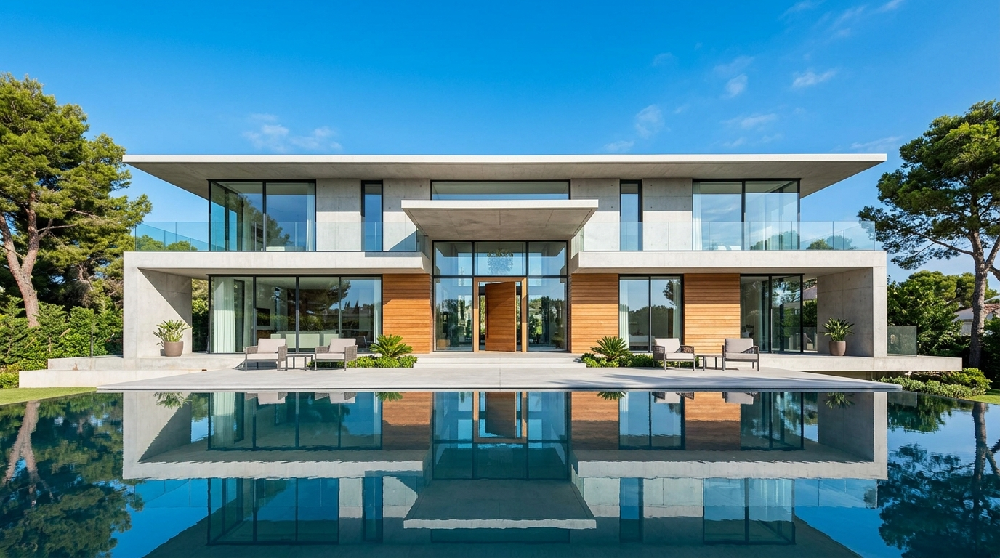

<p align="center">
  <picture>
    <source media="(prefers-color-scheme: dark)" srcset="src/assets/images/logo-full-dark.svg" />
    
  </picture>
</p>

# AuraVilla — Smart Real Estate & Luxury Home Platform

<p align="center">
  <b>Nền tảng giới thiệu biệt thự &amp; đầu tư bất động sản cao cấp (Hỗ trợ đa ngôn ngữ i18n, mặc định Tiếng Anh)</b><br>
  <i>Smart Real Estate &amp; Luxury Villa Showcase Platform (Multi-language i18n, English Default)</i>
</p>

<p align="center">
  <a href="https://github.com/ngyenpaul31may/AuraVilla"></a>
  
  
  
  
</p>

<p align="center">
  
</p>

---

## Giới thiệu & Thành phần giao diện chính (About & UI Highlights)

**AuraVilla** là ứng dụng web tĩnh (**HTML5 / CSS3 / Vanilla JavaScript**, không phụ thuộc framework) giới thiệu danh mục biệt thự, bất động sản kiến trúc hiện đại và bảng điều khiển phân tích đầu tư trực quan, hỗ trợ đa ngôn ngữ (**i18n**) với **Tiếng Anh (`en`) mặc định** và **2 giao diện Sáng / Tối**.

- **Floating Glass Pill Navigation:** Thanh điều hướng dạng viên thuốc kính mờ đặt giữa màn hình với biểu tượng logo `A/V`, bộ chuyển ngôn ngữ `EN | VI`, nút chuyển giao diện `Light / Dark` và ngăn kéo điều hướng cho màn hình nhỏ (`mobile-drawer`).
- **Blue-Sky Architectural Hero (`#home`):** Ảnh kiến trúc toàn cảnh (`hero-sky-villa.png`) kết hợp hai widget kính mờ nổi: **Occupancy Rate** (biểu đồ donut SVG `74 Houses` cùng các thẻ tỷ lệ) và **Bruce Walker** (`$242,491`).
- **Data-Driven Property Insights (`#features`):** 3 tab tương tác ARIA (`Market Analytics`, `Predictive Insights`, `Actionable Recommendations`) cập nhật trực tiếp biểu đồ cột & đường xu hướng Bézier SVG trong khung **Revenue**.
- **Featured Investment Properties (`#properties`):** Carousel 3 thẻ nghiêng đối xứng trình diễn 6 bất động sản chọn lọc (`Villa Redwood`, `The Cedar Pavilion`, `Skyline Edge`, `Solstice Cliff Villa`, `Courtyard Travertine`, `Aura Sky Penthouse`), nhãn trạng thái (`Under Offer`, `Rented`, `For Sale`) và **Property Detail Modal** (`#property-modal`) có focus trap.
- **Invest Today in *a Dream* House (`#dream-house`):** Banner chuyển sắc trời xanh – oải hương xếp lớp ảnh kiến trúc tách nền (`dream-house-cutout.png`) nổi trước chữ editorial và phía sau 3 thẻ kính mờ (`Smart Property`, `Growth Forecasting`, `Portfolio Optimization`).
- **Omni-Channel Bento Grid (`#about`):** Lưới 4 thẻ bất đối xứng gồm *Unified dashboard* (xem trước 3 bảng điều khiển với dải `Market Trends` & `Weekly schedule`), *Collaborative* (quả địa cầu wireframe tối màu & thẻ avatar cố vấn), *Smart homes. Smarter investments* (`eco-villas-aerial.png` kèm ghim giá) và *From single assets to a rental empire* (bảng **Lead Performing Agents** nghiêng 3D với thẻ nổi `Emily Gray` và `Bruce Walker`).
- **Footer & Private Advisory Modal (`#contact`, `#inquiry-modal`):** Footer 4 cột tối giản kèm nút liên kết mạng xã hội (`X`, `Instagram`, `Facebook`) và modal biểu mẫu đăng ký tư vấn riêng có kiểm tra dữ liệu phía client.

---

## Đa ngôn ngữ (i18n) & Giao diện Sáng / Tối (Themes)

### Đa ngôn ngữ (`src/js/i18n.js`)
- **Ngôn ngữ mặc định:** Tiếng Anh (`en`), khai báo `<html lang="en">`.
- **Tệp bản dịch:** `src/i18n/en.json` (chuẩn mặc định) và `src/i18n/vi.json` (đồng bộ 200 khóa dịch).
- **Cơ chế hoạt động:** Hỗ trợ tham số `?lang=en|vi`, lưu lựa chọn vào `localStorage` (`auravilla_lang`), tự động cập nhật `data-i18n`, `data-i18n-placeholder`, `data-i18n-aria`, metadata trang (`title`, `description`, `og:*`) và fallback an toàn về `en` (hoặc HTML dựng sẵn nếu `fetch` thất bại).

### 2 Giao diện Sáng / Tối (`src/js/theme.js`)
- **Giao diện mặc định:** **Light** (`data-theme="light"`) ở lần truy cập đầu tiên để đồng bộ với thiết kế chính, cho phép chuyển đổi sang **Dark** (`data-theme="dark"`).
- **Chống nháy giao diện (Anti-FOUC):** Script inline trong `<head>` đọc `localStorage` (`auravilla_theme`) trước khi render stylesheet; `theme.js` cập nhật `data-theme`, `colorScheme`, nhãn nút và đồng bộ theo sự kiện đổi ngôn ngữ `auravilla:langchange`.

---

## Hệ thống nhận diện & Design Tokens (Brand & Design System)

| Thành phần | Giá trị / Mô tả |
| :--- | :--- |
| **Màu nhấn chính (Cobalt Accent)** | `#2B50EC` / `#3E66FF` (Light) · `#6D8DFF` / `#8AA4FF` (Dark) |
| **Nền giao diện (Canvas & Surface)** | Light `#F4F5F7` / `#FFFFFF` · Dark `#0B0D12` / `#141720` |
| **Typography** | `Plus Jakarta Sans` (UI & tiêu đề, `400–700`) · `Cormorant Garamond` Italic (điểm nhấn editorial) |
| **Bộ logo SVG đồng bộ** | `logo-mark.svg`, `logo-full-light.svg`, `logo-full-dark.svg`, `favicon.svg` |

---

## Cấu trúc thư mục (Repository Structure)

```text
AuraVilla/
├── src/
│   ├── assets/
│   │   └── images/       # Bộ logo SVG, ảnh kiến trúc & dream-house-cutout.png, avatar cố vấn
│   ├── css/
│   │   └── style.css     # Hệ thống Design Tokens (Light/Dark), Bento Grid & hiệu ứng 3D/glass
│   ├── i18n/
│   │   ├── en.json       # Bản dịch Tiếng Anh (mặc định)
│   │   └── vi.json       # Bản dịch Tiếng Việt
│   ├── js/
│   │   ├── i18n.js       # Bộ xử lý đa ngôn ngữ (data-i18n, ?lang=, localStorage, fallback en)
│   │   ├── theme.js      # Bộ chuyển đổi Light (mặc định) / Dark & đồng bộ localStorage
│   │   └── main.js       # Tab Insights + biểu đồ SVG, carousel 3 thẻ, modal chi tiết & form tư vấn
│   └── index.html        # Trang chủ Landing Page (lang="en") kèm script anti-FOUC
└── README.md             # Tài liệu tổng quan dự án
```

---

## Lộ trình phát triển (Roadmap)

- [x] Khởi tạo Git repository (`main`) và tài liệu `README.md`.
- [x] Xây dựng bộ nhận diện thương hiệu SVG (`logo-mark`, `logo-full-light/dark`, `favicon`) và Design Tokens.
- [x] Thiết kế & hoàn thiện giao diện responsive với hero glass widgets, Bento Grid và hiệu ứng 3D (`src/index.html`, `src/css/style.css`).
- [x] Hoàn thiện hệ thống đa ngôn ngữ `i18n` mặc định Tiếng Anh (`en`) và Tiếng Việt (`vi`) (`src/i18n/`, `src/js/i18n.js`).
- [x] Hoàn thiện 2 giao diện Light (mặc định) / Dark chống FOUC (`src/js/theme.js`).
- [x] Xây dựng tab biểu đồ Data-Driven Insights, carousel bất động sản, modal chi tiết & modal đăng ký tư vấn có kiểm tra QA (`src/js/main.js`).
- [ ] Tích hợp backend/CRM thực tế cho biểu mẫu nhận tư vấn riêng tư.

---

## Cài đặt & Sử dụng (Getting Started)

```bash
git clone https://github.com/ngyenpaul31may/AuraVilla.git
cd AuraVilla
```

Chạy qua một static server cục bộ để trình duyệt `fetch` các file `src/i18n/*.json` ổn định:

```bash
npx serve src
# hoặc
python -m http.server 8000 --directory src
```

---

## Liên kết (Repository)

- **GitHub:** [ngyenpaul31may/AuraVilla](https://github.com/ngyenpaul31may/AuraVilla)
